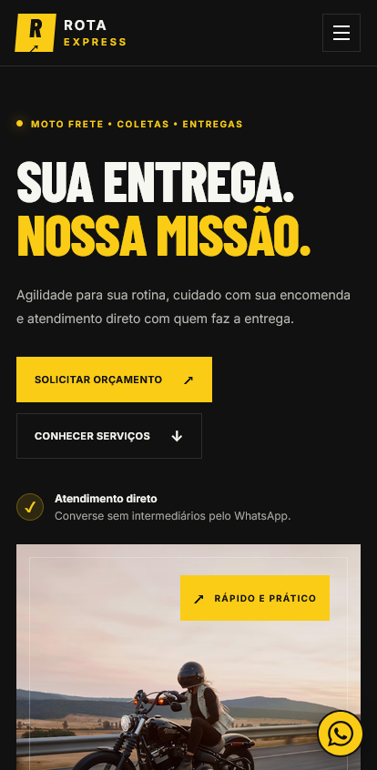
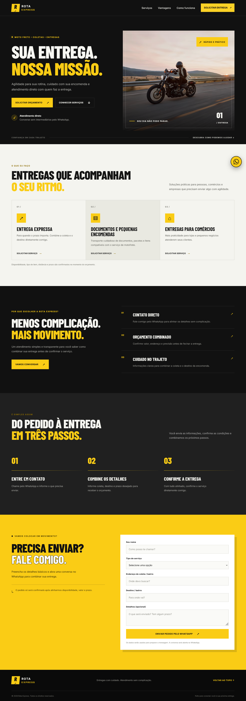

# Rota Express — Motorcycle Courier Landing Page

A professional, responsive landing page for an independent motorcycle courier, built with **HTML5, CSS3, and vanilla JavaScript**.

The website presents delivery services and allows visitors to request a quote through WhatsApp.

> **Portfolio project:** Rota Express is a demonstration brand. Replace the sample contact number, brand information, service area, and images before using the website for a real business.

## Features

- Responsive layout for desktop, tablet, and mobile.
- Modern black, yellow, and white visual identity.
- Hero section with a prominent call to action.
- Delivery services and business advantages sections.
- Three-step explanation of the delivery process.
- Quote request form integrated with WhatsApp.
- Floating WhatsApp contact button.
- Mobile navigation menu.
- Automatic service selection from service cards.
- Automatically updated footer year.
- Semantic HTML and visible keyboard focus.
- Reduced-motion accessibility support.
- No JavaScript frameworks or backend required.

## Demo mobile



## Demo web



## Tech Stack

- HTML5
- CSS3
- Vanilla JavaScript
- WhatsApp Click to Chat
- Git and GitHub

## Project Structure

```text
motoboy-landing-page/
├── index.html
├── css/
│   └── style.css
├── js/
│   └── script.js
└── README.md
```

## Getting Started

1. Clone or download this repository.
2. Open the project folder in Visual Studio Code.
3. Open `index.html` in your browser.
4. Alternatively, use the Live Server extension for automatic browser refresh while developing.

No Node.js installation or build process is required.

## WhatsApp Configuration

Open `js/script.js` and find the following constant:

```javascript
const WHATSAPP_NUMBER = "5511999999999";
```

Replace the sample value with the destination WhatsApp number, including the country code and area code.

Use digits only, without `+`, spaces, parentheses, or hyphens.

For example, `5511988887777` is a fictional Brazilian number.

Before deployment:

- Configure the correct WhatsApp number.
- Test the floating contact button.
- Submit a test quote request.
- Confirm that the generated message contains the correct fields.

The website opens WhatsApp with a pre-filled message. The visitor must send the message manually.

## Customization

Before using the project for a real business:

- Replace the Rota Express brand if necessary.
- Update the service descriptions and service area.
- Replace the sample image with an appropriate image you have permission to use.
- Configure the correct WhatsApp number.
- Add accurate business contact information.
- Review the website on desktop and mobile devices.

The typography is loaded from Google Fonts. An internet connection is required to load these fonts.

## Deployment — GitHub Pages

1. Create a public GitHub repository named `motoboy-landing-page`.
2. Upload `index.html`, the `css` and `js` folders, and this README to the repository root.
3. Open the repository's **Settings** page.
4. Select **Pages** in the sidebar.
5. Under **Build and deployment**, choose **Deploy from a branch**.
6. Select the `main` branch and the `/ (root)` folder.
7. Save the configuration.
8. Wait for GitHub Pages to publish the site and open the URL shown in the Pages settings.

GitHub Pages can host this static project without a backend.

## Limitations

- Does not calculate delivery prices automatically.
- Does not calculate routes or distances.
- Does not track deliveries.
- Does not store submitted quote requests.
- Requires the visitor to confirm the message in WhatsApp.
- The external image and Google Fonts require an internet connection.

## Future Improvements

- Add a real service-area section.
- Include a map of supported neighborhoods.
- Add a delivery price estimator.
- Improve SEO and social sharing metadata.
- Add optimized local images.
- Include screenshots of the deployed website.
